<div align="center">

  

  # 🏫 MarkMyDay
  ### School & College Management System

  **A comprehensive, role-based Android ERP application for administrators, teachers, and students.**

  [](https://www.android.com/)
  [](https://kotlinlang.org/)
  [](https://developer.android.com/jetpack/compose)
  [](https://firebase.google.com/)
  [-brightgreen.svg?style=flat-square)](https://developer.android.com/about/versions/12)
  [](LICENSE)

  [Features](#-features) • [Screenshots](#-screenshots) • [Architecture](#️-architecture) • [Tech Stack](#-technology-stack) • [Installation](#-installation--setup) • [My Contributions](#-my-contributions)

</div>

---

## 📖 Overview

**MarkMyDay** is a production-grade Android school management system built natively with **Kotlin** and **Jetpack Compose**. The application digitizes end-to-end educational operations by providing real-time, role-based access across three user types — administrators, teachers, and students.

The app demonstrates a wide range of modern Android development patterns including:
- **MVVM architecture** with Jetpack ViewModel and StateFlow
- **Firebase** real-time backend (Auth, Firestore, Cloud Messaging)
- **CameraX + ML Kit** for QR-based gate attendance
- A custom **Backtracking Constraint-Satisfaction Algorithm** for automated timetable generation
- **Multi-language support** (English, Telugu, Hindi, Punjabi) with instant hot-reloading

---

## 👥 User Roles & Features

### 🔑 Administrator
| Feature | Description |
|---|---|
| **Admissions Portal** | Full CRUD control — add, search, update, delete students and staff |
| **Timetable Generator** | Automated weekly scheduling via backtracking CSP algorithm |
| **Leave Management** | Review and approve/reject teacher and student leave requests in real-time |
| **Notifications** | Write and broadcast school-wide notices with FCM push notification support |
| **Attendance Insights** | View statistics and daily logs of teacher and student attendance |
| **Staff Management** | Edit and manage staff profiles, search by name or ID |
| **Student Management** | View all enrolled students with class filtering |
| **Course & Quiz** | Upload quiz question banks and course videos for teacher assignments |

### 👩‍🏫 Teacher (Faculty Portal)
| Feature | Description |
|---|---|
| **Attendance Marking** | Mark student attendance class-by-class and export logs to Excel (`.xlsx`) |
| **QR Gate Check-in** | Scan school gate QR codes via CameraX to log daily check-ins |
| **Digital Diary** | Post daily lesson summaries and homework assignments for students |
| **Quiz Management** | Bulk-upload quiz questions via CSV or Excel file imports |
| **Course Manager** | Upload YouTube course video links organized by subject |
| **Leave Request** | Submit leave applications and track approval status |
| **My Home Students** | View the roster of students assigned to the teacher's home section |

### 🎓 Student (Learning Adventure)
| Feature | Description |
|---|---|
| **Personal Dashboard** | View daily schedule, upcoming notices, and assignments |
| **Attendance Tracker** | View overall and subject-specific attendance statistics with charts |
| **Interactive Quizzes** | Take subject quizzes with auto-scoring and instant feedback |
| **E-Learning Center** | Browse and watch course video lectures uploaded by teachers |
| **Timetable Viewer** | View structured weekly class grid with teacher and subject information |
| **Digital Diary** | Access homework and lesson summaries posted by teachers |
| **Leaderboard** | Track quiz performance and class rankings competitively |
| **Leave Application** | Apply for leave with status tracking |

---

## 📸 Screenshots

### Role Dashboards

| Admin Dashboard | Teacher Dashboard & QR Check-in | Student Dashboard |
|:---:|:---:|:---:|
| 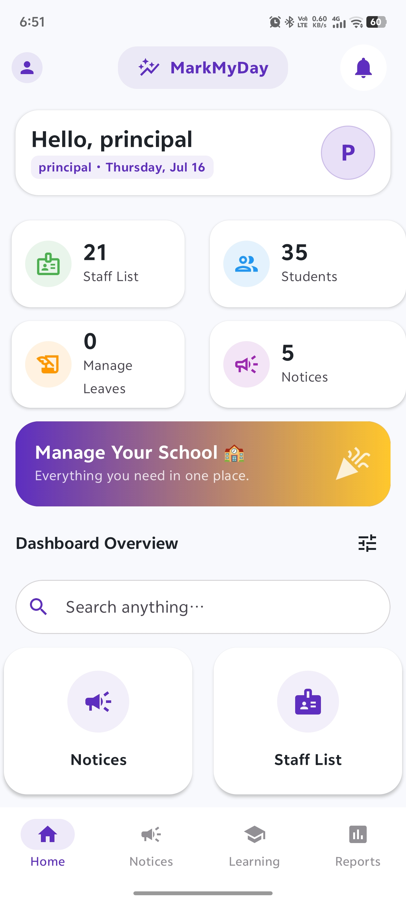 | 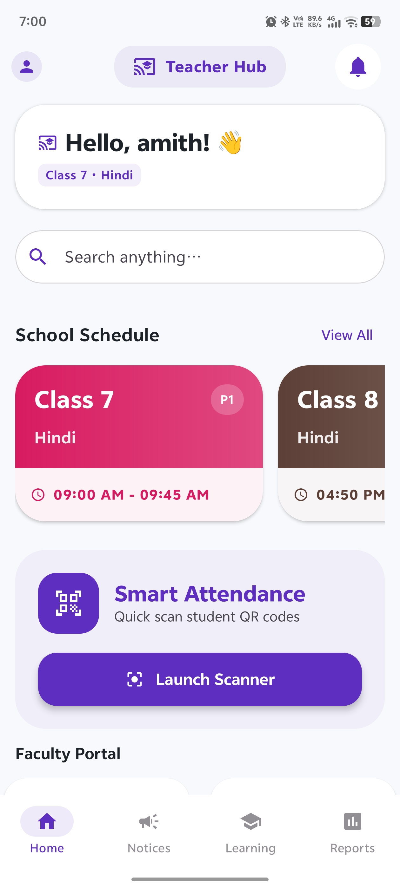 | 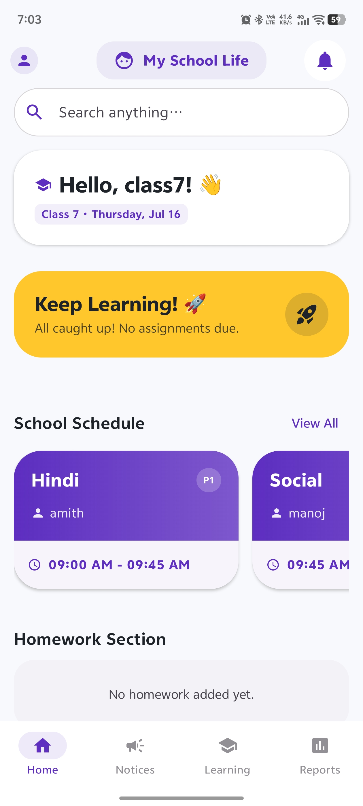 |

### Timetable Generation Flow

The timetable is auto-generated through a 3-step setup using the Backtracking CSP Algorithm:

| Step 1: Assign Home Teacher | Step 2: Assign Students | Step 3: Select Class |
|:---:|:---:|:---:|
| 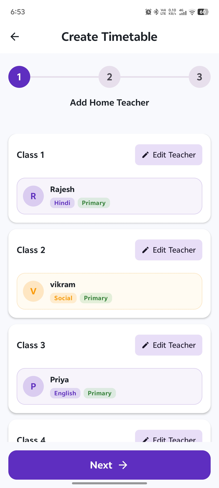 | 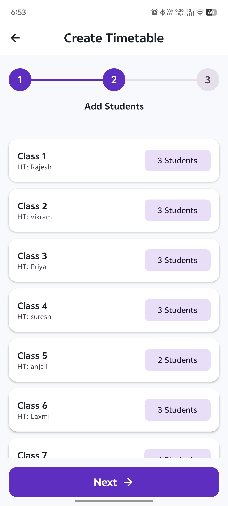 | 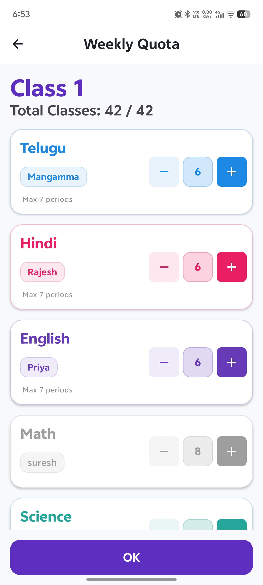 |

| Generated Weekly Timetable Grid |
|:---:|
| 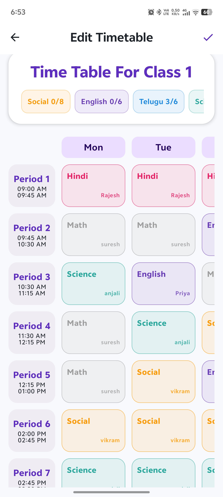 |

### Learning & Evaluation Portal

| Course Upload Manager | Course Video Player | Quiz Interface |
|:---:|:---:|:---:|
| 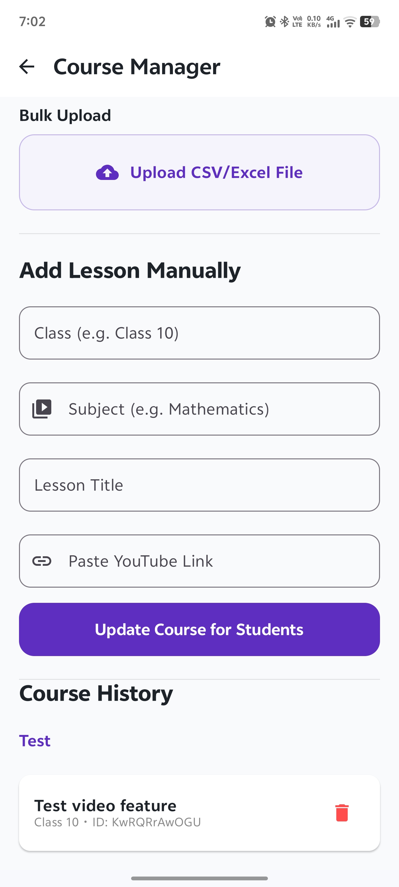 | 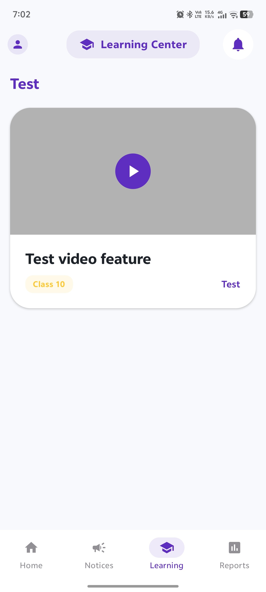 | 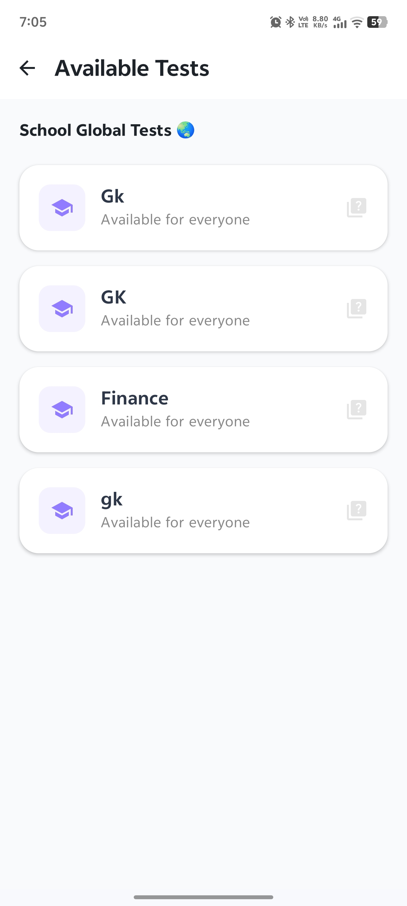 |

| Quiz Submission | Student Leaderboard | Leave Application |
|:---:|:---:|:---:|
| 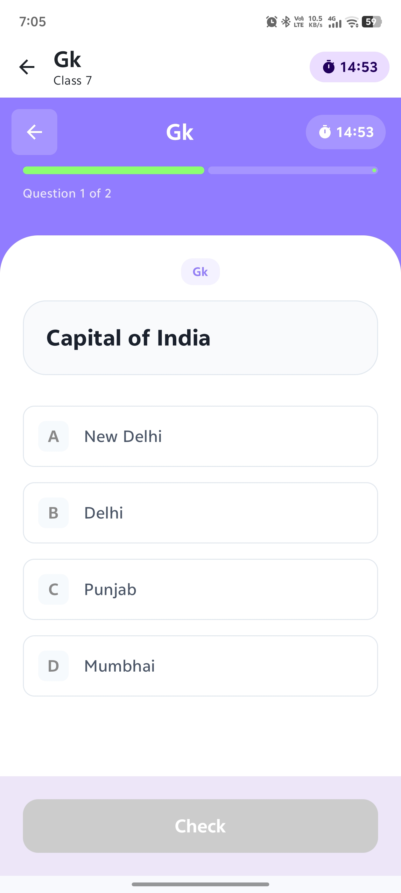 | 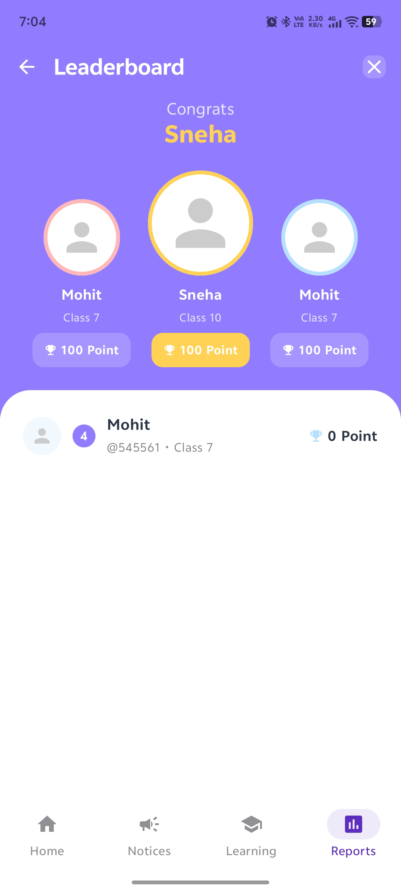 | 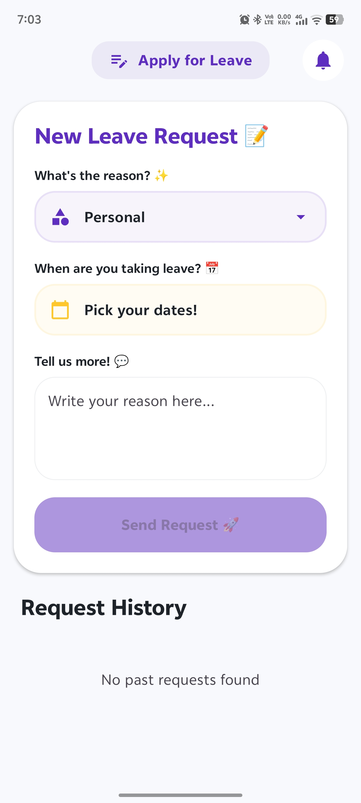 |

### Multi-Language Support

| Language Settings (4 Languages) | UI Translated to Telugu |
|:---:|:---:|
| 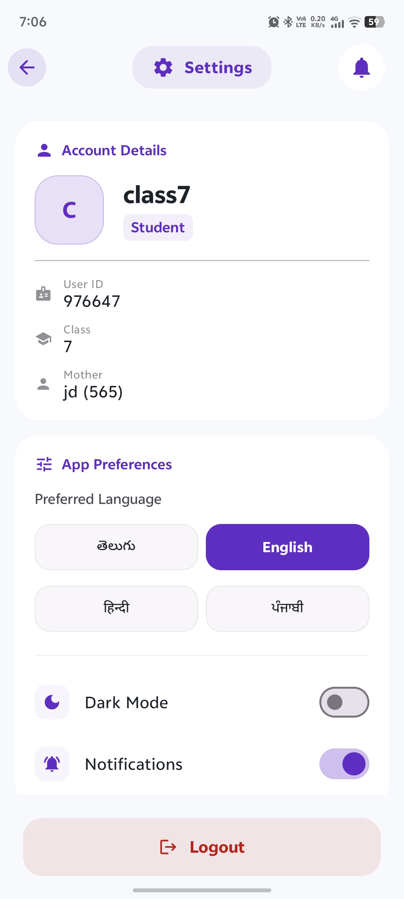 | 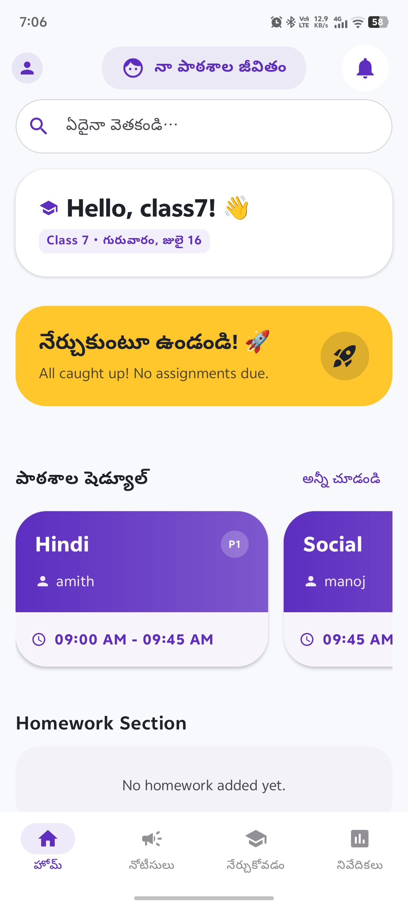 |

---

## 🛠️ Technology Stack

| Component | Technology | Version | Purpose |
|---|---|---|---|
| **Language** | Kotlin | 2.2.10 | Primary development language |
| **UI Framework** | Jetpack Compose + Material3 | BOM 2024.09.00 | Declarative, modern UI |
| **Architecture** | MVVM + Repository Pattern | — | Clean separation of concerns |
| **Backend** | Firebase Cloud Firestore | BoM 34.12.0 | Real-time NoSQL database |
| **Authentication** | Firebase Auth | BoM 34.12.0 | Secure email login |
| **Push Notifications** | Firebase Cloud Messaging | BoM 34.12.0 | Real-time broadcast alerts |
| **Navigation** | Jetpack Navigation Compose | 2.9.8 | Type-safe, role-based routing |
| **Camera** | CameraX | 1.6.1 | QR code scanning preview |
| **ML / Vision** | Google ML Kit Barcode | 17.3.0 | QR decoding at gate terminals |
| **File Processing** | Apache POI | 5.5.1 | Excel attendance import/export |
| **Network** | Retrofit2 + Gson | 2.11.0 | Educational news API client |
| **Image Loading** | Coil Compose | 2.6.0 | Async image rendering |
| **Charts** | Vico (Material3) | 3.1.0 | Attendance analytics charts |
| **Video Player** | Android YouTube Player | 13.0.0 | In-app course video playback |
| **Splash Screen** | AndroidX SplashScreen | 1.2.0 | Native splash screen API |
| **Preferences** | SharedPreferences | — | Dark mode, language, session |

---

## 🏗️ Architecture

MarkMyDay follows a clean **MVVM (Model-View-ViewModel)** architecture:

```
com.project.markmyday/
│
├── 📁 algorithm/
│   └── TimetableGenerator.kt       # Backtracking CSP timetable algorithm
│
├── 📁 data/
│   ├── 📁 api/                     # Retrofit service & instance (News API)
│   ├── 📁 model/                   # 16 Kotlin data classes (Student, Teacher, etc.)
│   └── 📁 repository/              # 9 Firestore-backed repositories
│
├── 📁 service/
│   └── MyFirebaseMessagingService  # FCM push notification handler
│
├── 📁 ui/
│   ├── 📁 auth/                    # Login & pre-login screens (Compose)
│   ├── 📁 components/              # Shared UI components (TopBar, BottomBar, tiles)
│   ├── 📁 models/                  # DashboardTile, TimetableEntry data models
│   ├── 📁 navigation/              # NavGraph.kt — 30+ Compose navigation routes
│   ├── 📁 screens/                 # 42 screen composable files
│   └── 📁 theme/                   # Color.kt, Theme.kt, Type.kt (Material3)
│
├── 📁 utils/
│   ├── CsvExporter.kt              # CSV export utility
│   ├── ExcelUtils.kt               # Apache POI Excel generator
│   ├── FCMUtils.kt                 # FCM topic subscription helpers
│   └── FileParser.kt               # CSV/Excel import parser
│
├── 📁 viewmodel/                   # 25 ViewModels (one per feature domain)
│
├── MainActivity.kt                 # Entry point, session check, theme setup
└── MarkMyDayApp.kt                 # Application class, dark mode initialization
```

### Data Flow Pattern

```
UI (Compose Screen)
        │  observes StateFlow
        ▼
  ViewModel (business logic, coroutines)
        │  calls suspend functions
        ▼
  Repository (data abstraction layer)
        │  reads/writes
        ▼
  Firebase Firestore (remote database)
```

### Key Algorithms

#### 📅 Backtracking Timetable CSP (`TimetableGenerator.kt`)
An advanced Constraint-Satisfaction Problem solver that:
1. **Quota Analysis** — Calculates required periods per subject based on class category
2. **Conflict Prevention** — Ensures teachers are not double-booked across classes
3. **Distribution Cap** — Limits any subject to max 3 periods per day
4. **Fatigue Management** — Prevents more than 2 consecutive periods of the same subject
5. **Backtracking** — Reverts failed slot assignments and tries alternative arrangements

#### 🔍 QR Gate Attendance (`ScanActivity.kt`)
Teachers scan terminal QR codes (`MARK_MY_DAY_GATE_01`) using CameraX streaming through Google ML Kit's Barcode Scanning API, which authenticates the terminal and writes an attendance log entry to Firestore.

---

## ⚙️ Installation & Setup

### Prerequisites
- **Android Studio** Meerkat or later
- **JDK 11** or later
- **Android device or emulator** running Android 12 (API 32) or later
- Access to the Firebase project (contact project administrators for `google-services.json`)

### Clone the Repository

```bash
git clone https://github.com/Vardhan1160/MarkMyDay.git
cd MarkMyDay
```

### Firebase Setup

> ⚠️ **Important**: This project uses Firebase as its backend. The `google-services.json` file included in this repository connects to the project's Firebase instance. You may need to contact the project administrators for database access credentials.

1. Open the project in Android Studio
2. The `google-services.json` is already present in `app/`
3. Sync the project with Gradle files

### Build & Run

```bash
# Build debug APK
./gradlew assembleDebug

# Install directly to connected device
./gradlew installDebug

# Run all unit tests
./gradlew test

# Run instrumented tests
./gradlew connectedAndroidTest
```

Or simply open in Android Studio and press **▶ Run**.

### Default Login

The app authenticates through Firebase. Use credentials provided by the system administrator. User IDs follow the format `<id>@gmail.com` — the app automatically appends `@gmail.com` if only an ID is entered.

---

## 🌐 Multi-Language Support

MarkMyDay supports **4 languages** with instant, restart-free language switching:

| Language | Code | Coverage |
|---|---|---|
| English | `en` | Full |
| Telugu (తెలుగు) | `te` | Full |
| Hindi (हिन्दी) | `hi` | Full |
| Punjabi (ਪੰਜਾਬੀ) | `pa` | Full |

Language changes use `AppCompatDelegate.setApplicationLocales()` and re-render the entire Compose UI via recomposition — **no app restart required**.

---

## ✨ My Contributions

This project was originally developed by the original team (credited below). As part of my **Android App Development Internship** at **Supraja Technologies**, I studied, analyzed, and extended the project with the following contributions:

### 🔍 Code Analysis & Documentation
- Performed a complete architectural analysis of the MVVM pattern across 42 screens and 25 ViewModels
- Documented the Backtracking CSP timetable algorithm and QR attendance flow
- Wrote this comprehensive README for the project repository

### 🐛 Bug Identification
- Identified the `MANAGE_DEVICE_POLICY_AUTOFILL` permission issue in `AndroidManifest.xml`
- Identified the stub FCM notification handler in `MyFirebaseMessagingService`
- Identified stub placeholder screens (`HappeningsScreen`, `ReportsScreen`) needing real data
- Noted the large image files (`preloginbackground.png` = 7.2 MB) causing APK bloat

### 📋 Repository Setup
- Created a professional `.gitignore` for Android/Kotlin projects
- Prepared and published the repository to GitHub with proper structure
- Wrote the installation and setup documentation

### 🎓 Skills Demonstrated
Through studying and working with this project, I developed hands-on experience with:
- **Jetpack Compose** — building declarative UIs with Material3 design
- **Firebase Integration** — Firestore queries, real-time listeners, Auth flows
- **MVVM + StateFlow** — reactive state management in Android
- **Jetpack Navigation** — Compose Navigation with URI-encoded route parameters
- **CameraX + ML Kit** — camera preview and barcode scanning integration
- **Kotlin Coroutines** — `viewModelScope.launch`, `suspend` functions, `await()`
- **Multi-language (i18n)** — per-language string resources and `AppCompatDelegate` locales

---

## 👥 App Team

| Developer | GitHub | Role |
|---|---|---|
| **Yash** | [@yashreddy1154](https://github.com/yashreddy1154) | Android Developer (Original) |
| **Tarak** | [@Tarakreddy011](https://github.com/Tarakreddy011) | Android Developer (Original) |
| **Teja Reddy** | [@TejaReddyKuru](https://github.com/TejaReddyKuru) | Android Developer (Original) |
| **Guthula Venkata Sahitya Vardhan** | [@Vardhan1160](https://github.com/Vardhan1160) | Android Developer — Portfolio Contributor |

---

## 📄 License

This project is for educational and portfolio purposes. Original source code is the work of the original creators (Yash, Tarak, Teja Reddy). Extended and documented by Guthula Venkata Sahitya Vardhan as part of an Android development internship.

---

<div align="center">
  <sub>Built with ❤️ using Kotlin & Jetpack Compose • Firebase Backend • Material Design 3</sub>
</div>
